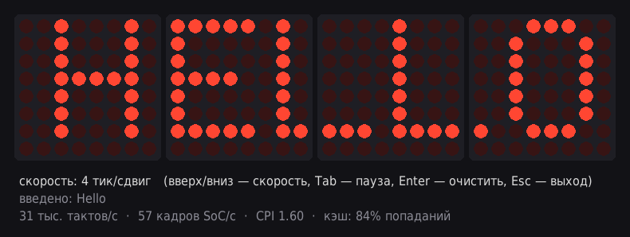

# SoC «Бегущая строка» — курсовая работа по ВС АСОИУ

Группа **ИУ5-51Б**, вариант **2**, 2026. Цель — оценка «5».

16-битный процессор с 5-стадийным конвейером, кэшем данных и MMIO-периферией на Verilog, собственный ассемблер на Python и три программы для него. Бегущую строку можно «потрогать руками»: окно pygame показывает 4 LED-матрицы, а текст набирается на клавиатуре ПК, уходит в процессор по UART и сразу появляется на матрицах.



| Оценка | Задача варианта | Где |
| --- | --- | --- |
| «3», №1 | **Числа Фибоначчи**: N в RAM[0x00], F(N) в RAM[0x01]; программа в машинных кодах | `asm/fib_manual.rom.hex` |
| «4», №13 | **Chat Terminal (Echo)**: приём по UART, строчные → заглавные, отправка обратно | `asm/echo.asm` |
| «5», №24 | **Marquee**: приём ASCII по UART, шрифт в ROM, плавный попиксельный сдвиг по нескольким LED-матрицам; кастомная инструкция **`FONT_RENDER`** | `asm/marquee.asm`, `rtl/font_render.v` |

## Быстрый старт

Нужны Icarus Verilog ≥ 11, Python 3.10–3.14 (cocotb 2.x пока не поддерживает 3.15), `cocotb` ≥ 2.0 и `pygame`. Для `make lint`, `make synth` и просмотра диаграмм — ещё Verilator, Yosys и GTKWave.

```bash
# Ubuntu / Debian / WSL
sudo apt install iverilog verilator yosys gtkwave make
pip install cocotb pygame

# macOS (Python из Homebrew ставит пакеты только в виртуальное окружение)
brew install icarus-verilog verilator yosys make python@3.13
brew install --cask gtkwave
python3.13 -m venv .venv
source .venv/bin/activate        # в каждом новом окне терминала
pip install cocotb pygame
```

```bash
make            # шрифт + все программы -> build/
make test       # все тесты (Verilog + cocotb), около полуминуты
make play       # бегущая строка в окне — играть руками
make play-echo  # Chat Terminal в том же окне
make wave       # временные диаграммы -> build/fib.vcd
```

**Управление в окне:** кликните по окну и печатайте — текст дописывается в строку и сразу виден; Backspace стирает последний символ, Enter очищает; ↑ / ↓ — быстрее / медленнее; Tab — пауза; Esc — выход. Шрифт латинский, строчные показываются заглавными. При русской раскладке клавиша даёт свою латинскую букву (Й → Q).

## Что сделано

**Аппаратура (Verilog, `rtl/`)**
- 16-битное RISC-ядро: 8 регистров, R0 = 0, 21 команда в форматах R / I / U / J — [docs/ISA.md](docs/ISA.md)
- конвейер IF–ID–EX–MEM–WB; Hazard Unit: forwarding, load-use stall, flush при переходе
- кэш данных прямого отображения с имитацией медленной RAM (Miss Penalty 4 такта)
- шина с MMIO-декодером: RAM, видео-буфер 32 × 8 с защёлкой кадра, UART 8N1 с очередью на 16 байт, кнопки и таймер
- **`FONT_RENDER rd, rs1, rs2`** — столбец глифа 5 × 7 за один такт вместо примерно семи команд
- `verilator --lint-only -Wall` без предупреждений; синтез в Yosys: 1 011 LUT, 1 440 триггеров, 2 блока BRAM — [docs/SYNTH.md](docs/SYNTH.md)

**Программы и инструменты**
- ассемблер `tools/asm.py`: два прохода, метки, `.equ`, выражения, `hi()/lo()`, `.data/.word/.string/.space/.org`, 14 псевдокоманд, включая «длинные» переходы, листинг, ошибки с номером строки — [docs/ASM.md](docs/ASM.md)
- Фибоначчи вручную в машинных кодах и на ассемблере; cross-verification — коды совпадают
- Chat Terminal и бегущая строка с бесконечным игровым циклом: ввод → логика → отрисовка

**Проверка** — [docs/TESTS.md](docs/TESTS.md)
- 6 Verilog-тестбенчей и 5 cocotb-тестов; каждый кадр на матрицах сверяется с моделью на Python, стресс-тест — 1000 кадров со случайным вводом
- интерактивный мост cocotb + pygame: живая игра с клавиатуры ПК в реальном времени, 30 000 тактов в секунду — [docs/ARCH.md](docs/ARCH.md#интерактивный-мост)

## Архитектура

```
cpu_core (IF → ID → EX → MEM → WB, hazard)
   │IF                         │MEM
 imem ROM 1K×16              bus ─┬─ dcache ── dram RAM 256×16   0x0000–0x00FF
                                  ├─ vram 32×8 + LATCH           0x8000–0x8020
                                  ├─ dev_uart (RX FIFO, TX)      0xFF00–0xFF02
                                  └─ dev_input (кнопки, таймер)  0xFF03–0xFF04
```

Подробная схема и описание модулей — [docs/ARCH.md](docs/ARCH.md).

## Структура репозитория

```
rtl/        Verilog: ядро, память, шина, устройства, soc_top.v
asm/        программы: fib, fib_manual (машинный код), echo, marquee, isa_test
tools/      asm.py — ассемблер, gen_font.py — Font ROM и эталон, vcd_plot.py — диаграммы в PNG
tb/         Verilog-тестбенчи
bridge/     cocotb + pygame: интерактивный мост и автотесты
docs/       ISA, архитектура, ассемблер, тесты, синтез, картинки
```

## Технические проблемы, которые пришлось решить

1. **Конфликты данных в конвейере.** Тело цикла Фибоначчи — цепочка зависимых команд. Forwarding из EX/MEM и MEM/WB и сквозная запись в регистровом файле убирают все простои, кроме load-use (1 такт). На диаграмме в [TESTS.md](docs/TESTS.md#временные-диаграммы) это видно по сигналам `forward A/B`.
2. **Forwarding не срабатывал в Icarus.** Первая версия выбирала источник операнда функцией Verilog, читавшей сигналы модуля. `assign y = f(x)` пересчитывается только при смене аргумента `x`, а не сигналов внутри `f`, поэтому F(N) выходил неверным начиная с N = 2. Решение — явные выражения вместо функций в `hazard.v` и `regfile.v`.
3. **Короткие переходы.** У условного перехода 6 бит смещения, ±31 команда. Обработчик UART в бегущей строке длиннее, поэтому в ассемблере появились `LBEQ/LBNE/LBLT` — обратное условие плюс `JMP`.
4. **Кэш и MMIO.** Если бы `STATUS` UART попал в кэш, цикл ожидания вечно читал бы старое «пусто». Поэтому область `0x8000–0xFFFF` кэш обходит.
5. **Разрыв кадра.** Программа рисует кадр 32 записями, и окно могло прочитать видео-буфер посередине: половина столбцов уже сдвинута, половина ещё нет. Теперь запись идёт в теневой буфер, а на матрицы кадр попадает целиком одной записью в `LATCH` — как у сдвиговых регистров с защёлкой.
6. **Реальное время в симуляторе.** Скорость Icarus зависит от машины и нагрузки. Мост выдаёт SoC ровно 500 тактов на каждое из 60 обновлений окна в секунду, а строка сдвигается по аппаратному таймеру, поэтому скорость одинакова на любом компьютере. Чтобы хватало запаса, такт формируется в C++ (`impl="gpi"`), а Python ждёт одним таймером на много тактов вместо каждого фронта: симуляция ускорилась примерно с 20 до 50 тыс. тактов в секунду.
