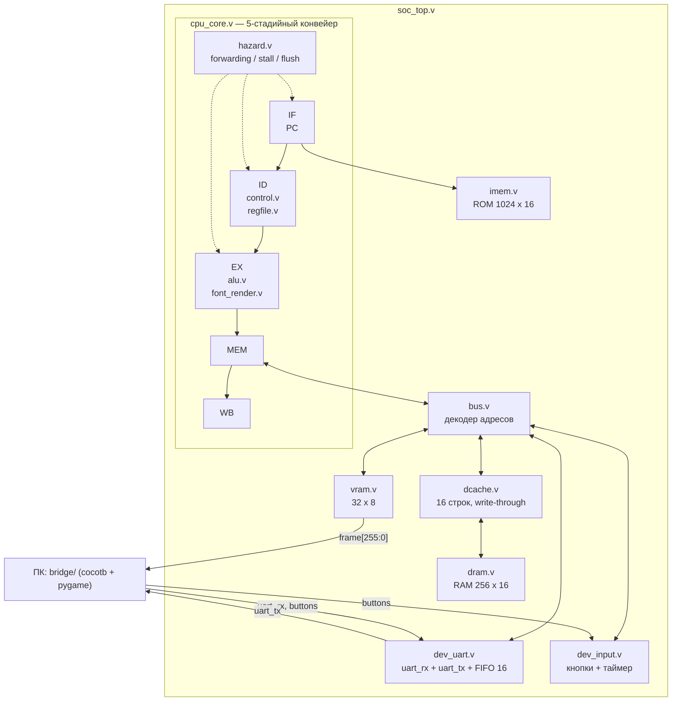

# Архитектура SoC

## Схема модулей

Та же схема картинкой — в отчёте; здесь — для GitHub (Mermaid).

## Модули

| Файл | Что делает |
| --- | --- |
| `rtl/isa.vh` | коды операций, функций, внутренних операций АЛУ |
| `rtl/soc_top.v` | верхний уровень: соединяет ядро, память, шину и устройства |
| `rtl/cpu_core.v` | конвейер: PC, регистры IF/ID, ID/EX, EX/MEM, MEM/WB, логика переходов |
| `rtl/control.v` | декодер команды: управляющие сигналы, номера регистров, константа |
| `rtl/regfile.v` | 8 × 16, R0 = 0, синхронная запись, сквозное чтение записываемого |
| `rtl/alu.v` | ADD, SUB, AND, OR, XOR, NOT, SHL, SHR, LUI, LLI; флаги Z, N, C |
| `rtl/font_render.v` | кастомная инструкция: Font ROM 384 × 8 и вычисление индекса |
| `rtl/hazard.v` | forwarding, load-use stall, flush, заморозка при промахе кэша |
| `rtl/imem.v` | ROM команд, `$readmemh` из `+rom=` |
| `rtl/bus.v` | декодер адресов стадии MEM, мультиплексор чтения |
| `rtl/dcache.v` | кэш прямого отображения: 16 строк по слову, тег 4 бита |
| `rtl/dram.v` | RAM данных, второй порт на чтение для окна отладки |
| `rtl/vram.v` | видео-буфер, весь кадр выведен шиной `frame` |
| `rtl/dev_uart.v`, `uart_rx.v`, `uart_tx.v` | UART 8N1 с очередью приёма на 16 байт |
| `rtl/dev_input.v` | кнопки и таймер кадров |

## Конвейер

| Стадия | Что происходит |
| --- | --- |
| IF | команда из ROM по PC; PC + 1, если нет останова |
| ID | `control` декодирует, регистровый файл читает два операнда; `hazard` ищет load-use |
| EX | forwarding-мультиплексоры → АЛУ / `FONT_RENDER`; сравнение для `BEQ/BNE/BLT`; адрес перехода |
| MEM | адрес = результат EX; шина выбирает RAM через кэш, видео-буфер или MMIO |
| WB | запись в регистровый файл; `HALT` в WB останавливает процессор |

Переходы решаются в EX. Предсказания нет: процессор всегда продолжает выборку подряд (статически «переход не выполнен»), а при выполненном переходе сбрасывает две младшие команды. Цена выполненного перехода — 2 такта.

## Кэш данных

Прямое отображение, 16 строк по одному слову. Адрес RAM 8 бит: `[3:0]` — индекс, `[7:4]` — тег.

- **Чтение, попадание** — данные в том же такте, без простоя.
- **Чтение, промах** — `stall = 1`, весь конвейер заморожен на `MISS_PENALTY` тактов (по умолчанию 4: так имитируется медленная основная память), затем строка заполняется и команда продолжается.
- **Запись** — сквозная (write-through) без выделения строки: RAM пишется всегда, строка обновляется только при попадании. Поэтому кэш и RAM никогда не расходятся, и вытеснение не требует обратной записи.
- **MMIO и видео-буфер кэш обходят.** Иначе цикл ожидания `STATUS` прочитал бы закэшированное «очередь пуста» и завис навсегда.

Счётчики попаданий и промахов выведены наружу и печатаются тестами и окном моста. Попадание считается и в такте, когда только что заполненная строка отдаёт данные, поэтому каждый промах добавляет ещё и одно попадание.

## Устройства MMIO

Каждое устройство само проверяет своё окно адресов (параметр `BASE`) и вне окна отдаёт 0, поэтому выходы всех устройств объединяются по ИЛИ: `mmio_rd = uart_rd | input_rd`. Чтобы добавить устройство, достаточно поставить экземпляр и добавить его `rd` в это ИЛИ.

**UART** — настоящий последовательный 8N1: приёмник с двойной синхронизацией входа, отсчёт в середине бита, `CLKS_PER_BIT = 16`. Принятые байты попадают в кольцевую очередь на 16 байт: процессор может отвлечься на отрисовку кадра и не потерять вставленный текст. Если очередь полна, байт отбрасывается и поднимается флаг переполнения.

**Таймер** считает тики (`TICK_DIV` тактов). Бегущая строка сдвигается по таймеру, а не по числу выполненных команд, поэтому скорость не зависит от длины текста и промахов кэша.

## Интерактивный мост

`bridge/` — Python + cocotb + pygame. cocotb запускает `soc_top` в Icarus Verilog и подаёт такт. Каждые 2000 тактов мост:

1. читает шину `frame` (весь видео-буфер за одно обращение) и рисует 4 матрицы 8×8;
2. обрабатывает клавиатуру: печатные символы ставит в очередь UART, стрелки и Tab держит на входах `buttons`;
3. печатает статистику: такт, CPI, попадания и промахи кэша, скорость симуляции.

Байты по UART передаются побитово отдельной сопрограммой (`soc_io.py`), как от настоящего ПК, поэтому через мост проверяется и сам приёмник UART.
