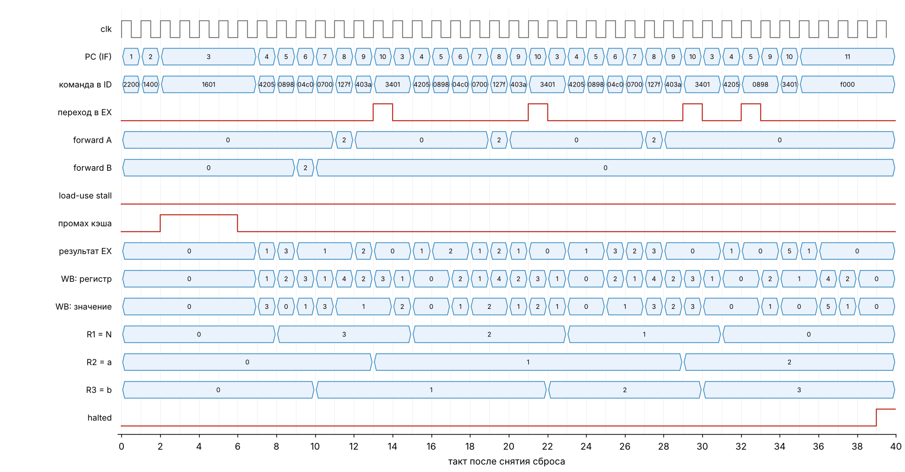

# Тестирование

`make test` запускает всё: Verilog-тестбенчи под Icarus Verilog и cocotb-тесты на Python. Каждый тест печатает `PASS`/`FAIL` и итоговое `ALL TESTS PASSED`.

## Verilog-тестбенчи (`make test-rtl`)

| Тестбенч | Что проверяет | Результат |
| --- | --- | --- |
| `crosscheck` | ручной машинный код Фибоначчи = вывод ассемблера | совпадает слово в слово |
| `tb/tb_font.v` | `FONT_RENDER`: все коды 0..127 × столбцы 0..7 против Python-модели | 1024 из 1024 |
| `tb/tb_uart.v` | приём по линии → очередь → `RX_DATA`; `TX_DATA` → линия 8N1; переполнение очереди | 3 из 3 |
| `tb/tb_fib.v` (ручной код) | Фибоначчи на SoC для N = 0, 1, 2, 3, 10, 20, 24 | 7 из 7 |
| `tb/tb_fib.v` (ассемблер) | то же с кодом из `asm/fib.asm` | 7 из 7 |
| `tb/tb_isa.v` | `asm/isa_test.asm`: 10 групп — все команды, forwarding, load-use, flush, CALL/RET, `FONT_RENDER`, видео-буфер | 6 из 6 проверок |
| `tb/tb_echo.v` | Chat Terminal: «hello, World!» по UART → «HELLO, WORLD!» | совпадает |
| `tb/tb_marquee.v` | бегущая строка: кадры псевдографикой, дописывание текста, пауза | 2 из 2 |

### Производительность Фибоначчи

| N | F(N) | Тактов | Команд | CPI |
| --- | --- | --- | --- | --- |
| 0 | 0 | 16 | 6 | 2,66 |
| 1 | 1 | 24 | 12 | 2,00 |
| 10 | 55 | 96 | 66 | 1,45 |
| 24 | 46 368 | 208 | 150 | 1,38 |

CPI выше 1 из-за двух тактов на каждый выполненный переход (`BEQ R0, R0, loop` в конце каждой итерации), заполнения конвейера и одного промаха кэша (4 такта) на `LW N`. Конфликты данных в теле цикла стоят 0 тактов: их снимает forwarding.

## cocotb-тесты (`make test-cocotb`)

`bridge/test_marquee.py` гоняет SoC с бегущей строкой и сверяет кадр с эталонной моделью на Python.

| Тест | Что проверяет |
| --- | --- |
| `frame_matches_model` | 32 столбца видео-буфера = модель: окно, лента из RAM и таблица шрифта |
| `scroll_moves_one_column` | после снятия паузы окно движется по таймеру |
| `typing_edits_tape` | по UART: печать дописывает, Backspace стирает, Enter очищает и гасит экран |
| `speed_buttons` | кнопки: 4 → 2 → 1 → 1 (минимум), затем до 64 (максимум) |
| `stress_long_run` | 600 000 тактов с непрерывным вводом: лента не выходит за RAM, процессор не встаёт |

Результат: 5 из 5. Стресс-тест: CPI 1,61, кэш 41 160 попаданий / 8 858 промахов.

## Временные диаграммы

`make wave` пишет `build/fib.vcd`. Открыть в GTKWave с сохранённым набором сигналов:

```bash
gtkwave build/fib.vcd docs/fib.gtkw
```

Без GTKWave: `python3 tools/vcd_plot.py build/fib.vcd docs/img/fib_wave.png --run 4 --cycles 40`.



Что видно на диаграмме (N = 3):

- **такты 2–5** — промах кэша на `LW R1, n(R0)`: `промах кэша = 1`, PC и команда в ID стоят;
- **такт 9** — `forward B = 2`: `ADD R4, R2, R3` берёт R3 из MEM/WB, не дожидаясь записи;
- **такт 11** — `forward A = 2`: `ADD R3, R4, R0` берёт R4, вычисленный двумя командами раньше;
- **такты 13, 21, 29** — `переход в EX`: `BEQ R0, R0, loop`, PC возвращается на 3, две команды сброшены;
- **такт 32** — выход из цикла, `SW` и `HALT`; `halted` = 1 на такте 39, R2 = 2 = F(3).
